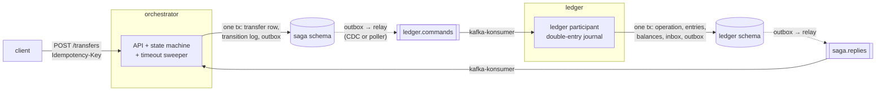

# ledger-saga

Money transfers between sharded ledger accounts as an orchestrated saga
(hold → capture → credit, refund and release as compensations), in several
currencies without conversion, with a
transactional outbox shipped to Kafka by CDC or by a poller, three layers of
idempotency, and a crash harness that SIGKILLs a real process at every step
boundary and then audits the books.

## What is proven, and how

| claim | evidence |
|---|---|
| Money is conserved and nothing is applied twice, under any delivery order, duplication or loss | property test: rapid drives the real state machine and ledger decision function through adversarial schedules (`internal/sim`) |
| …and under real crashes | [crash matrix](docs/chaos-matrix.md): 11 crash points × 5 seeds + 5 no-crash baselines = **60/60 runs pass**, 12,062 transfers, 55 SIGKILLs, with duplicates, reordering and late redelivery injected on every run |
| …and under load | every benchmark run ends with the same audit: **292,204 sagas over 7 runs, 0 violations** |
| Money never crosses currencies | the property test draws account currencies and lets clients name the wrong one; removing the currency check from either hold or credit fails on the first schedule. Every chaos run seeds USD and EUR accounts, and the audit checks conservation per currency and that every leg is in its account's currency. A forged operation that balances but pays EUR into a USD account is reported ([ADR-0008](docs/adr/0008-currencies-checked-by-the-ledger-no-conversion.md)) |
| A stuck saga pages someone | `saga_stuck{state}` and `saga_oldest_open_seconds` from the orchestrator, with the `SagaStuck` and `SagaStuckDetectorAbsent` alerts tested by `promtool test rules` in CI. An integration test shows an undeliverable saga being counted. Every chaos run requires the restarted orchestrator to export the gauge and read 0 at rest ([ADR-0009](docs/adr/0009-stuck-sagas-are-a-gauge-and-an-alert.md)) |
| The harness can see a bug | removing the one `if` that fences a late hold makes 6 of 8 runs fail; the harness had to be changed before it could see it ([ADR-0007](docs/adr/0007-crash-harness-real-processes-sigkill-at-named-points.md)) |
| No data races | `go test -race` on every package, unit and integration; one seed of the crash matrix on race-enabled binaries of all three services: 12/12 runs, 0 race reports (CI repeats this on every push) |
| Each idempotency layer holds on its own boundary | Testcontainers tests on Postgres 17 + Kafka 3.9: 32 concurrent POSTs with one key create one transfer; a poison message goes to the DLQ and the partition moves on; a retried hold replays the original refusal after the account is topped up |

## Numbers

All from real runs; raw output in [`results/`](results/). Closed-loop
clients: each creates a transfer and long-polls it until terminal, so the
latency is the whole saga (three ledger round trips through two relays and
two consumers), not the POST.

| measurement | result |
|---|---|
| throughput, 100 clients | 615–768 sagas/s over 4 runs (CDC and poller), saga p50 118–146 ms, p99 200–490 ms |
| throughput, 1000 clients | 742–825 sagas/s over 3 clean runs, p99 2.6–2.9 s: saturated, commands queue in front of the ledger consumer while Postgres uses ~1.2 of 4 cores |
| recovery after SIGKILL, process down 5–10 s, 100 clients | backlog accepted before the restart is terminal **0.7 s** after restart (ledger), **0.5 s** (orchestrator), **3.2 s** (relay); 0 transfers cancelled; 0 violations |
| outbox → consumer delivery, 100 clients | p50 16–23 ms, p99 62–85 ms, CDC and poller alike |
| database cost at idle | poller +178 transactions/s, CDC +1 |
| crash matrix wall time | 6 min 54 s for 60 runs, 4 in parallel |

Per-run tables: [CDC vs poller (ADR-0004)](docs/adr/0004-transactional-outbox-cdc-and-poller.md#measurements),
[crash matrix](docs/chaos-matrix.md).

**Hardware.** Apple M4 Max (16 cores, 48 GiB) host; everything runs in one
colima VM with 4 vCPU and 4 GiB, shared with other workloads on the same
laptop (the host was swapping during the runs). Container limits: Kafka
1.5 GiB (1 GiB heap), Postgres 1 GiB (`shared_buffers=256MB`), each service
256 MiB. Postgres 17.6 with `synchronous_commit=on`, Kafka 3.9.1 single
broker, 16 partitions per topic, `acks=all`. Two of the runs contain
multi-second disk stalls of the VM (iowait up to 98% with no block writes);
they are left in, which is why the ranges are wide. Expect higher and
tighter numbers on dedicated hardware.

**Where the ceiling is.** At 1000 clients the ledger consumer is the queue
(command delivery p50 364 ms vs 21 ms for replies): kafka-konsumer handles
32 messages at a time and commits after the slowest one. More partitions
and consumer instances, or the batch consumer with one transaction per
batch, are the next step; Postgres is not the limit yet.

## Architecture



- **Orchestrator** (`internal/saga`): HTTP API, the pure state machine
  (`machine.go`), and a sweeper that turns deadlines into retries or a
  release. Every state change, its transition-log row and the next command
  commit in one transaction.
- **Ledger** (`internal/ledger`): executes one command per transaction
  against one account and its shard's clearing account, by a pure
  `Decide` function. Records every decision under `(saga, step)` and replays
  it for duplicates.
- **Relay** (`internal/relay`): ships both outboxes to Kafka, either from
  the WAL with [go-pq-cdc-kafka](https://github.com/Trendyol/go-pq-cdc-kafka)
  or by polling with `FOR UPDATE SKIP LOCKED`.
- **Consumers** (`internal/consumer`): [kafka-konsumer](https://github.com/Trendyol/kafka-konsumer)
  with inbox dedup, in-process backoff, a retry topic and a dead-letter topic.

States: `HOLD_PENDING → CAPTURE_PENDING → CREDIT_PENDING → COMPLETED`;
`HOLD_PENDING → REJECTED` (insufficient funds, frozen source, source not in
the transfer's currency);
`HOLD_PENDING → RELEASE_PENDING → CANCELLED` (hold timed out);
`CREDIT_PENDING → REFUND_PENDING → REFUNDED` (destination frozen, missing or
in another currency).

## Decisions

| ADR | |
|---|---|
| [0001](docs/adr/0001-orchestrated-saga-hold-capture-credit-refund.md) | Orchestrated saga; hold → capture → credit, refund as compensation; credit is the pivot |
| [0002](docs/adr/0002-timeouts-only-hold-gives-up-release-fences.md) | Only hold gives up on timeout; release leaves a tombstone that fences a late hold; grace after restart |
| [0003](docs/adr/0003-double-entry-journal-with-shard-clearing-accounts.md) | Double-entry journal, per-shard clearing accounts without balance rows, the invariants |
| [0004](docs/adr/0004-transactional-outbox-cdc-and-poller.md) | Transactional outbox; CDC vs poller |
| [0005](docs/adr/0005-three-layers-of-idempotency.md) | Idempotency: API key, inbox, natural key with replay |
| [0006](docs/adr/0006-retry-ladder-and-dead-letter.md) | Retry ladder and DLQ; kafka-konsumer settings that must not be left at default |
| [0007](docs/adr/0007-crash-harness-real-processes-sigkill-at-named-points.md) | Crash harness; how it was itself tested; what it found |
| [0008](docs/adr/0008-currencies-checked-by-the-ledger-no-conversion.md) | Currencies: the client names one, the ledger checks it at hold and credit, no conversion; per-currency invariants |
| [0009](docs/adr/0009-stuck-sagas-are-a-gauge-and-an-alert.md) | Stuck sagas: a periodic gauge, an alert, and an alert on the detector's absence |

## Reproduce

Needs Docker (with Compose v2) and Go 1.26.

```bash
make test              # unit + property tests with -race
make test-integration  # Testcontainers: Postgres 17 + Kafka 3.9
make chaos             # crash matrix, rewrites docs/chaos-matrix.md
make bench             # load + recovery, writes results/bench/
make up                # the stack; Grafana on :3000, Prometheus (with alerts) on :9090, API on :8080
```

Host ports are overridable (`PG_PORT`, `KAFKA_PORT`, `API_PORT`,
`GRAFANA_PORT`, `PROMETHEUS_PORT` in `.env`) when the defaults are taken.

```bash
curl -s -XPOST localhost:8080/transfers -H 'Idempotency-Key: k1' -d '{"from":1,"to":2,"amount":100,"currency":"USD"}'
curl -s 'localhost:8080/transfers/<id>?wait=5s'
```

## Layout

```
cmd/ledgersaga/   one binary: migrate | seed | orchestrator | ledger | relay | check | load | recovery | chaos
internal/saga/    state machine, store, HTTP API
internal/ledger/  decision function, store
internal/sim/     property test of both against an adversarial network
internal/check/   invariant audit
internal/consumer kafka-konsumer wiring, retry ladder, chaos injection
internal/relay/   outbox → Kafka: CDC and poller
internal/it/      Testcontainers integration tests
deploy/           Prometheus config and alert rules (with promtool tests), Grafana provisioning
```

## How it was built

The code, tests and documentation in this repository were written by the AI
agent Claude Code (Anthropic), from Rabiya's problem statement and under her
direction. The claims above do not depend on taking that on trust: each one
names the test, run or file that checks it, and the commands in
[Reproduce](#reproduce) rerun them.
